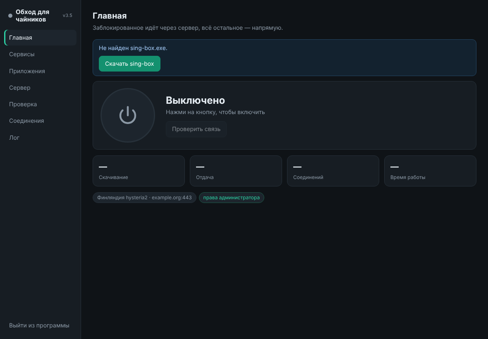
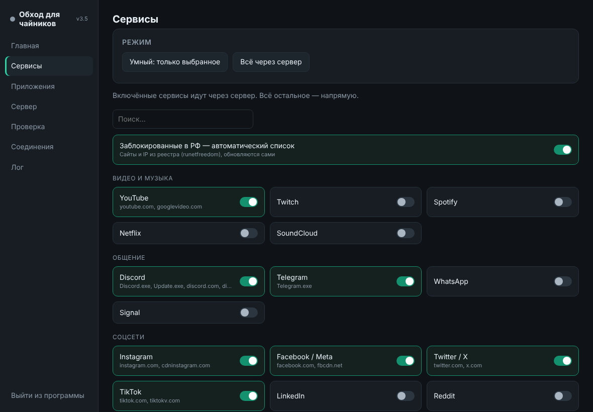
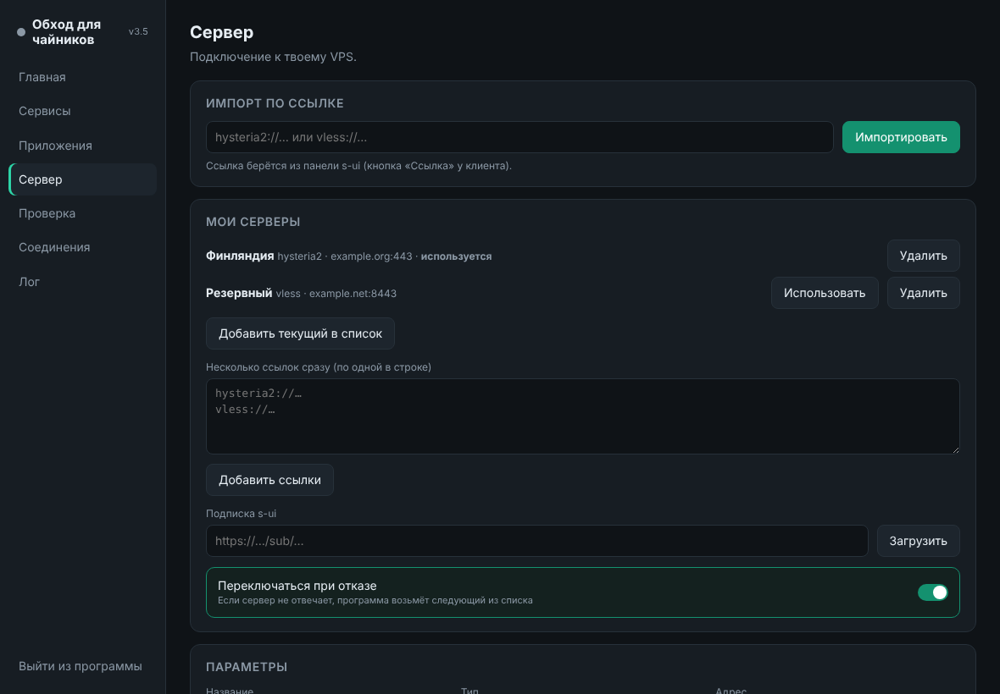

# Обход для чайников

Программа для Windows, которая отправляет **заблокированные** сайты и сервисы (YouTube, Instagram, Discord, Telegram и другие) через ваш собственный сервер, а **всё остальное** оставляет напрямую: российские сайты и игры работают как обычно, без потери скорости.

Работает поверх [sing-box](https://github.com/SagerNet/sing-box) (и [Xray-core](https://github.com/XTLS/Xray-core) для транспорта xhttp). Свой сервер нужен: программа к нему подключается, но сам VPN не предоставляет.

## Возможности

- **Сервисы одним переключателем.** YouTube, Discord, Telegram, Instagram, Twitter/X, TikTok и ещё около 20. Плюс автоматический список заблокированных в РФ сайтов (runetfreedom), обновляется сам.
- **Свои правила.** Отдельные сайты и программы: через сервер или напрямую.
- **Два режима.** «Умный» (только выбранное) и «Всё через сервер» (кроме .ru).
- **Протоколы.** Hysteria2, VLESS (TCP, WebSocket, Reality, xhttp).
- **Несколько серверов** с автопереключением, если основной перестал отвечать. Импорт ссылкой или подпиской s-ui.
- **Вкладка «Проверка».** Показывает, почему сайт открывается или нет и через что он идёт.
- **Сторож соединения.** Сам перезапускает туннель и присылает уведомление в трее.
- **Автообновление** с проверкой подписи.
- Значок в трее, автозапуск вместе с Windows, кнопка «Собрать отчёт» без паролей.

| Сервисы | Сервер |
|---|---|
|  |  |

## Установка

1. Скачайте `Obhod-vX.Y.zip` из раздела [**Releases**](../../releases/latest).
2. Распакуйте в любую папку, например `C:\Obhod` (не в «Загрузки» и не на рабочий стол: рядом будет создана папка `data` с настройками).
3. Запустите `Обход для чайников.exe` и согласитесь на запрос прав администратора: без них туннель не включится.
4. Вкладка **«Сервер»**: вставьте ссылку `hysteria2://…` или `vless://…` из панели вашего сервера и нажмите «Импортировать». При необходимости нажмите «Скачать / обновить sing-box».
5. На главной нажмите большую кнопку питания.

Windows может показать предупреждение SmartScreen, потому что программа не подписана коммерческим сертификатом. Нажмите «Подробнее» → «Выполнить в любом случае».

## Обновление

Программа сама проверяет новые версии и предлагает **«Обновить»**. Подпись и контрольная сумма проверяются перед установкой, старая версия сохраняется как `.bak`.

## Частые вопросы

**Ничего не открывается после включения.** Откройте вкладку «Проверка» и введите адрес сайта. Если не помогло, нажмите «Собрать отчёт» на вкладке «Сервер».

**Конфликтует с другим VPN.** Выключите другие VPN и WARP на время работы программы.

**Где хранятся пароли?** Только в папке `data` рядом с программой. Не выкладывайте её никуда.

## Для автора: как выпустить обновление

См. [docs/RELEASING.md](docs/RELEASING.md).

---
*Проект для личного использования. Исходный код не публикуется.*
